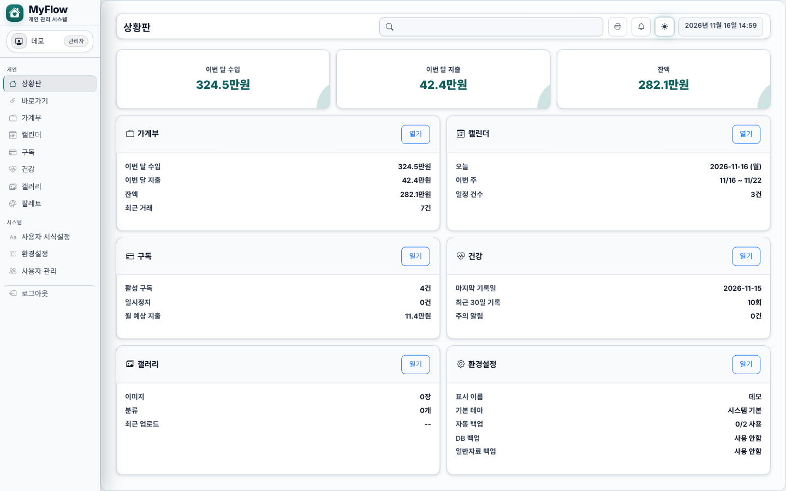
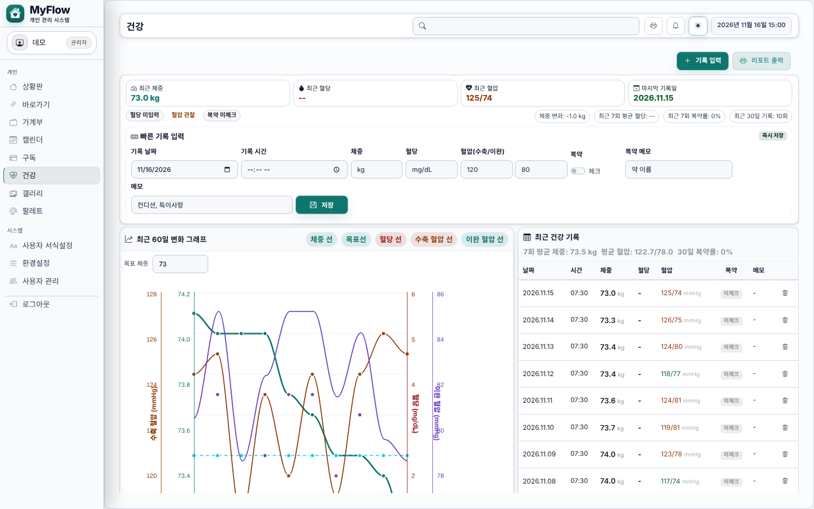

# MyFlow

> A self-hosted personal life dashboard: household finances, subscriptions, health logs,
> schedules, shortcuts and color palettes — in one Flask + PostgreSQL web app on Docker.

가계부, 구독, 건강 기록, 일정, 바로가기를 **한 곳에서 관리하는 개인용 웹 대시보드**입니다.
내 서버(홈랩)에 Docker로 올려 두고 브라우저로 접속해 씁니다.

| 상황판 | 건강 기록 |
|---|---|
|  |  |

<sub>화면 속 자료는 모두 예시 데이터입니다.</sub>

---

## 주요 기능

- **가계부** — 수입·지출 기록과 조회
- **구독 관리** — 정기 결제 서비스 목록, 사용·중지 전환
- **건강 기록** — 날짜별 건강 수치 기록과 조회
- **일정** — 대시보드 일정 요약과 달력 화면
- **바로가기** — 자주 가는 사이트를 묶음별로 정리
- **색상 팔레트** — 디자인 작업용 색 조합 저장
- **자동 백업** — 화면에서 정한 요일·시간에 DB와 파일을 자동으로 백업 (별도 백업 컨테이너)
- **로그인** — 개인 정보를 보호하기 위한 계정 로그인

> 준비 중: 대출 관리, 갤러리, 가계부 분류·결제수단 편집, 엑셀 내보내기 (화면만 있고 저장 기능은 다음 단계에서 연결 예정)

## 기술 스택

| 구분 | 사용 기술 |
|---|---|
| 서버 | Python · Flask · Flask-Login · Flask-WTF |
| DB | PostgreSQL 15 · SQLAlchemy |
| 실행 | Gunicorn |
| 배포 | Docker · Docker Compose (웹앱 + DB + 백업 스케줄러) |

## 빠른 시작

```bash
./scripts/setup_env.sh          # .env 만들기 (POSTGRES_PASSWORD 등 값 채우기)
docker compose up -d --build
```

브라우저에서 `http://<서버 주소>:985` 로 접속합니다.

## 더 알아보기

환경값 설정, 운영 반영 스크립트, 폴더 역할은 **[docs/GUIDE.md](docs/GUIDE.md)** 에 정리해 두었습니다.

---

만든 사람: [hunmonkey](https://github.com/hunmonkey)
